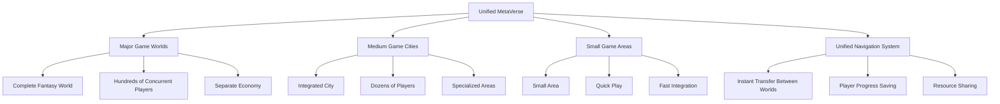
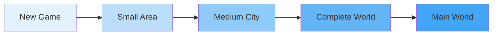
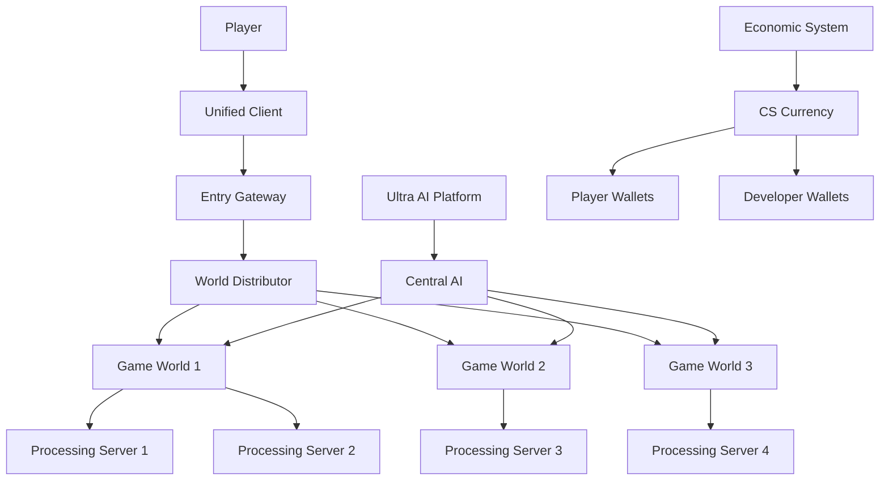
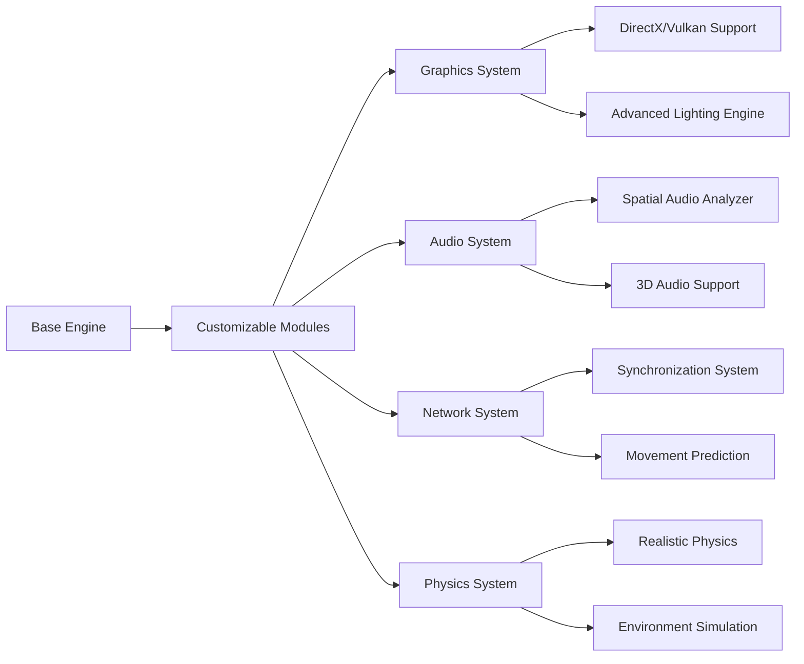
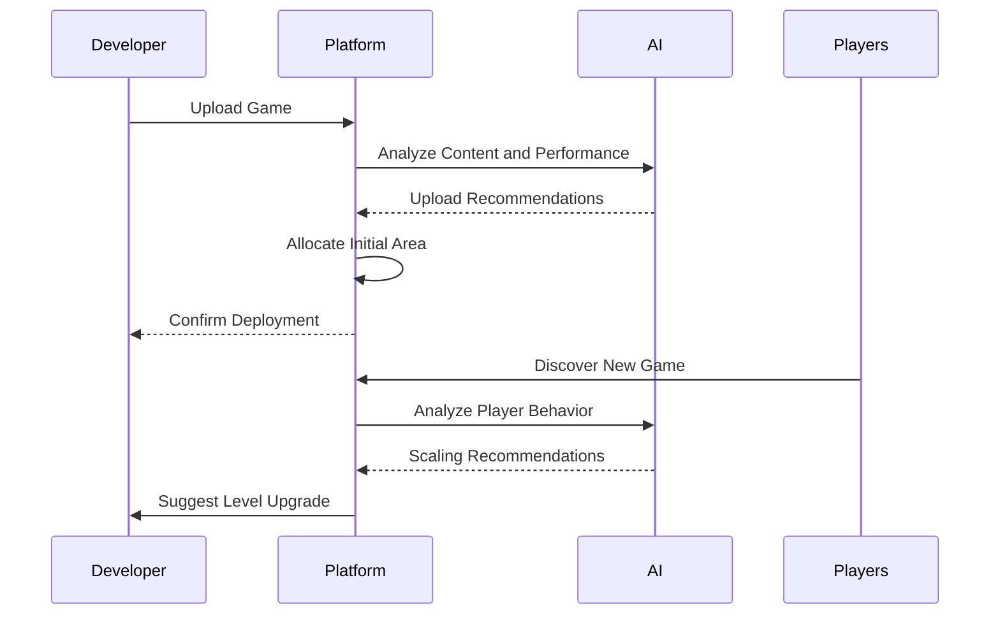
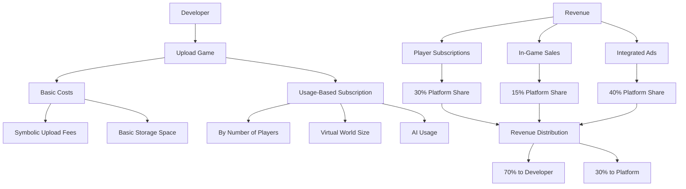
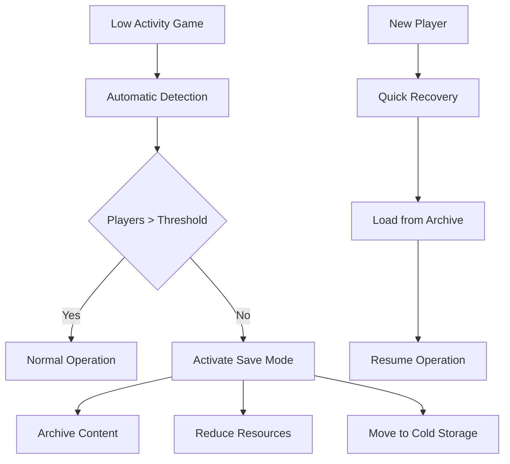
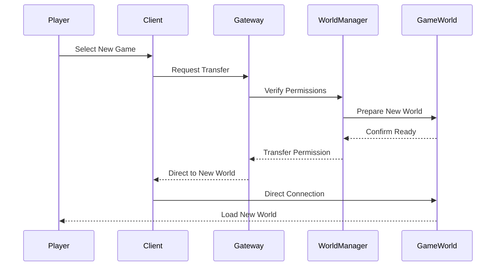
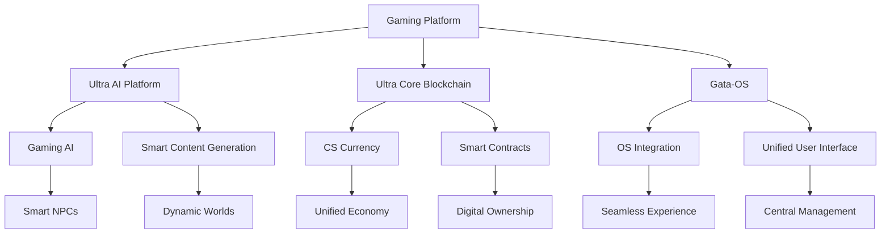
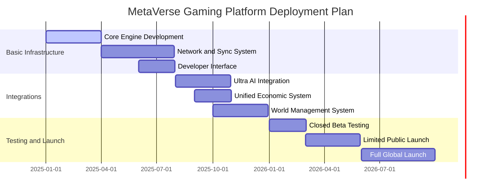

# 🎮 MetaVerse Gaming Platform - Open Metaverse Gaming Platform


**Version**: 1.0.0 | **Status**: In Planning 🧠 | **Architecture**: Unified Metaverse Gaming Platform | **Design Quality**: 10/10

[](https://www.ucubetech.com)
[](LICENSE)
[](https://github.com/Ultra-Cube/Ultra-AI-Platform)

## 🌟 Overview

The MetaVerse Gaming Platform is a unified virtual world that brings together different games in a comprehensive MMORPG environment. Instead of building separate games, developers can host their games within our unified world, creating a continuous and infinitely scalable player experience.



## ✨ Unique Features

### 1. Unified and Comprehensive Gaming World
- **Game Integration**: Transform separate games into interconnected worlds
- **Seamless Navigation**: Player transition between games without re-login
- **Unified Progress**: Save player progress across all connected games
- **Shared Economy**: Unified currency usable in all worlds

### 2. Smart World Scaling System


**Scaling Levels:**
- **Level 1**: Small areas (up to 50 players)
- **Level 2**: Medium cities (up to 500 players)
- **Level 3**: Complete worlds (up to 5000 players)
- **Level 4**: Main worlds (over 5000 players)

### 3. Ultra AI Platform Integration
- **AI for Players**: Smart NPCs that adapt to player behavior
- **Dynamic Content Generation**: Automatically create quests and worlds
- **Game Performance Analysis**: Recommendations for improving player experience
- **Developer Support**: Smart tools for content creation and management

### 4. Unified Economic System
- **CS Digital Currency**: Unified currency for all transactions
- **Interconnected Markets**: Exchange items between different worlds
- **Flexible Subscription System**: Operating costs proportional to game size
- **Developer Rewards**: Revenue shares based on game performance

## 🏗️ Technical Architecture

### Unified Architecture


### Unified Game Engine


## 🚀 Getting Started for Developers

### Game Lifecycle in the Platform


### Technical Integration
```javascript
// Basic integration code example
class MetaVerseGame {
  constructor(gameConfig) {
    this.gameId = gameConfig.id;
    this.initialSize = gameConfig.initialSize || 'small';
    this.maxPlayers = gameConfig.maxPlayers || 50;
    this.integrationLevel = gameConfig.integrationLevel || 'basic';
  }
  
  async initialize() {
    // Automatic loading in the platform
    const allocation = await this.platform.allocateSpace(this.initialSize);
    this.world = await this.createWorld(allocation);
    
    // Integration with economic system
    this.economy = new PlatformEconomy(this.gameId);
    
    // Connection to AI platform
    this.ai = new UltraAIIntegration(this.gameId);
  }
  
  async scaleUp(newSize) {
    // Automatic scaling on demand
    const newAllocation = await this.platform.upgradeSpace(this.gameId, newSize);
    await this.expandWorld(newAllocation);
  }
}
```

## 💰 Economic Model

### Cost and Revenue Structure


### Proposed Pricing System
| Game Level | Monthly Cost | Features |
|------------|-------------|----------|
| **Small Area** | $29 | Up to 50 players, 10GB space |
| **Medium City** | $99 | Up to 500 players, 100GB space |
| **Complete World** | $299 | Up to 5000 players, 1TB space |
| **Main World** | $999 | Unlimited, custom support |

## 🛡️ Game Preservation System

### Automatic Saving System


### Protection Features:
- **Automatic Archiving**: Safely save inactive games
- **Instant Recovery**: Resume operation when players return
- **Data Transfer**: Move player characters between games
- **Game Museum**: Display stopped games as virtual museums

## 🎮 Unique Player Experience

### World Navigation


### Advanced Player Features:
- **Unified Player Card**: One character for all games
- **Interconnected Achievements**: Achievements across multiple games
- **Permanent Friendships**: Friend list works across all worlds
- **Unified Digital Wallet**: CS currency for all transactions

## 🔧 Developer Tools

### Integrated SDK
```bash
# Install development tools
npm install -g ultragame-sdk

# Create new game
ultragame create my-rpg-game

# Local testing
ultragame dev

# Deploy to platform
ultragame deploy --size small
```

### Reusable Modules
```javascript
// Trading module example
import { TradingSystem } from 'ultragame-sdk';

class MyGameTrading extends TradingSystem {
  constructor() {
    super({
      currency: 'CS', // Use unified currency
      crossGame: true, // Allow inter-game trading
      fees: 0.02 // 2% platform fees
    });
  }
  
  async listItem(item, price) {
    // List item in unified market
    return await this.platformMarket.list(item, price);
  }
}
```

## 🌐 Ultra Cube Ecosystem Integration

### Comprehensive Connection


## 📊 Deployment and Scaling Plan

### Timeline


## 💡 Proposed Improvements and Additions

### 1. Smart Content Discovery System
- Recommendation algorithms based on player preferences
- Customized worlds based on each player's interests
- Shared events across multiple games

### 2. Advanced Analytics Tools for Developers
- Comprehensive game performance dashboard
- Player behavior analytics
- Smart recommendations for content improvement

### 3. Integrated Social Platform
- Player groups across worlds
- Inter-game shared events
- Integrated live streaming system

### 4. Future Technology Support
- Virtual and Augmented Reality
- Generative Artificial Intelligence
- Blockchain for digital asset ownership

## 🎯 Benefits for Developers and Players

### For Developers:
- ✅ Save 70% of infrastructure costs
- ✅ Instant access to ready player base
- ✅ Free advanced development tools
- ✅ Continuous revenue from unified economic system

### For Players:
- ✅ Continuous gameplay experience across multiple games
- ✅ Progress saved across all worlds
- ✅ Unified and fair economy
- ✅ Easy discovery of new games

---

**✨ Developed by Ultra Cube Tech** - [www.ucubetech.com](https://www.ucubetech.com)
