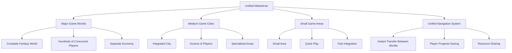
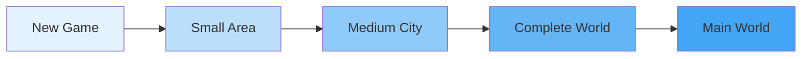
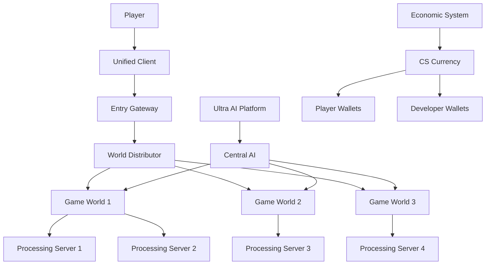
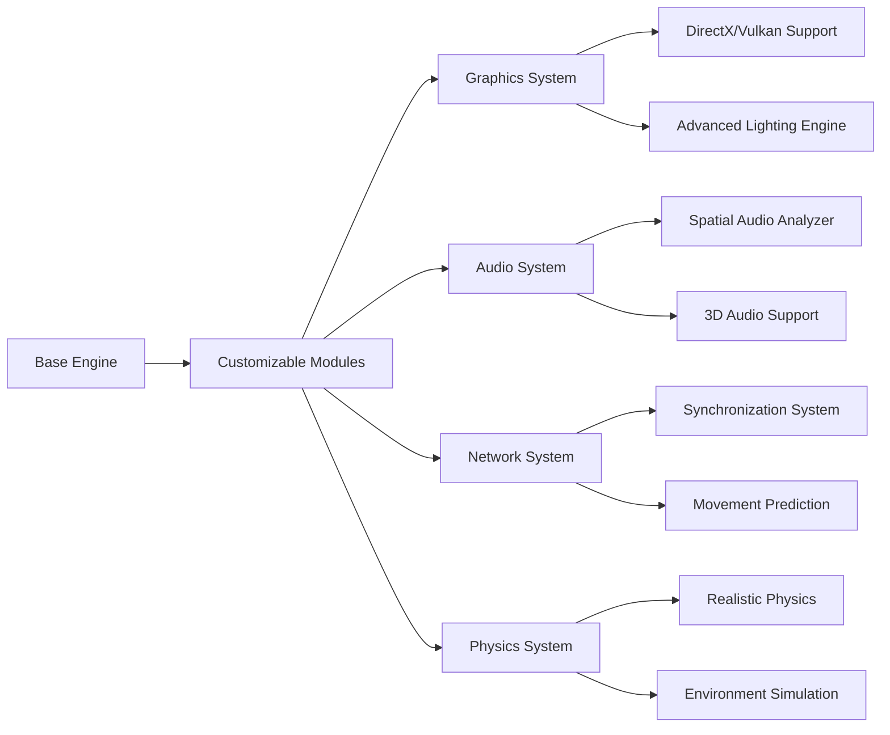
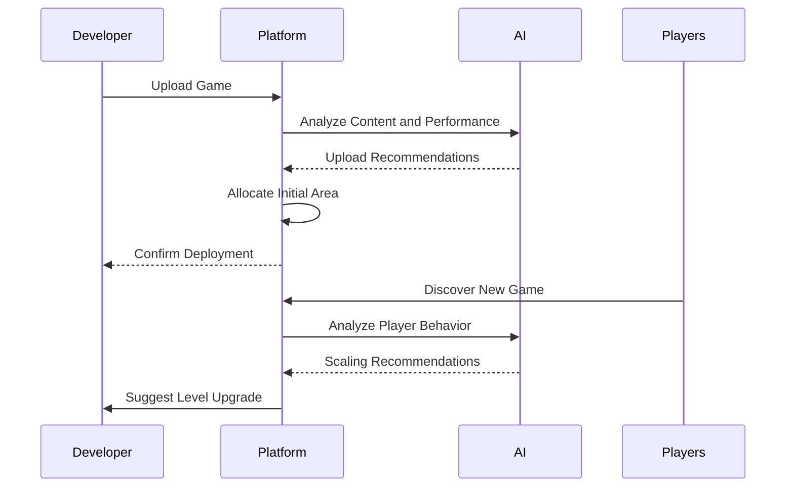
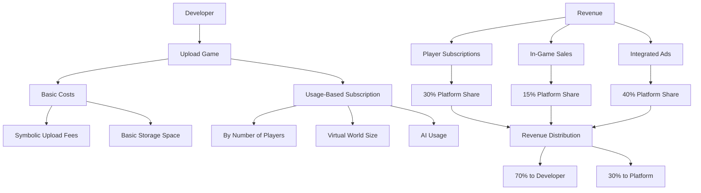
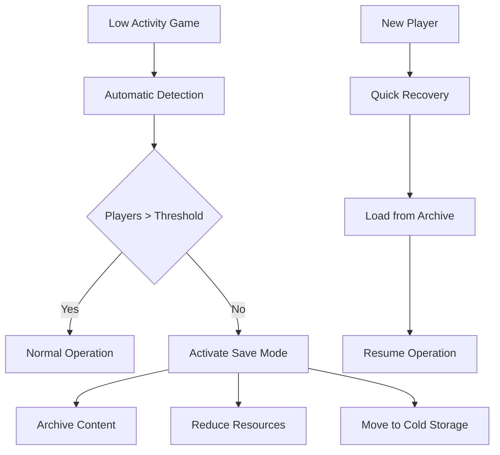
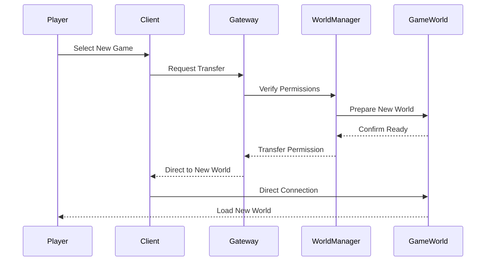
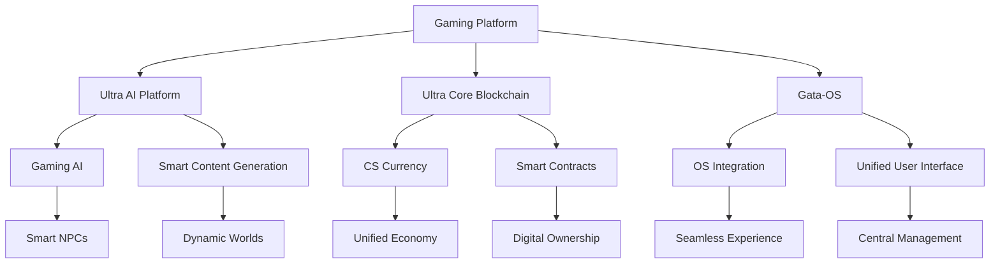
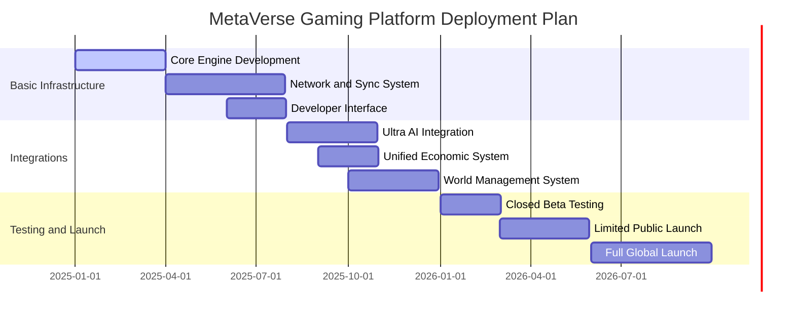

# 🎮 Ultra-MetaVerse - AI-Powered Gaming & Development Platform


**Version**: 1.0.0 | **Status**: In Development 🚀 | **Architecture**: Unified AI & Gaming Platform | **Design Quality**: 10/10

[](https://www.ucubetech.com)
[](LICENSE)
[](https://github.com/Ultra-Cube/Ultra-AI-Platform)

Ultra-MetaVerse is a comprehensive platform that combines two revolutionary aspects:

## 🤖 AI Development Platform
An AI-powered development platform that integrates existing AI engines with a self-evolving intelligence core. The system simplifies user experience through adaptive UI/UX, dynamically generates tools based on user requests, and connects with Gata-OS for cross-environment navigation.

## 🎮 MetaVerse Gaming Platform  
A unified virtual world that brings together different games in a comprehensive MMORPG environment. Instead of building separate games, developers can host their games within our unified world, creating a continuous and infinitely scalable player experience.



## 🌟 Key Features

### 🧠 Self-Evolving Intelligence Core
- **Adaptive Learning**: Continuously learns from user behavior and system performance
- **Emotional Responsiveness**: Adjusts responses based on emotional context and user needs
- **Performance Optimization**: Self-optimizes based on usage patterns and effectiveness metrics
- **Pattern Recognition**: Identifies and adapts to user workflows and preferences

### 🎨 Adaptive UI/UX System
- **Dynamic Interface Adaptation**: Automatically adjusts interface complexity based on user skill level
- **Behavioral Learning**: Tracks user interactions to optimize interface layout and features
- **Emotional Context Awareness**: Adapts visual elements and messaging tone based on user state
- **Real-time Personalization**: Continuously refines user experience through machine learning

### 🛠️ Dynamic Tool Generation
- **On-Demand Tool Creation**: Generates custom tools based on natural language descriptions
- **Emotional Intelligence**: Creates tools with appropriate emotional tone and user support level
- **Contextual Awareness**: Considers current project and workflow context in tool design
- **Continuous Improvement**: Learns from tool usage to improve future generations

### 🤖 Multi-AI Engine Integration
- **Universal AI Interface**: Seamlessly integrates with OpenAI, Anthropic, Google, Hugging Face, and Cohere
- **Intelligent Engine Selection**: Automatically selects optimal AI engine based on task requirements
- **Load Balancing**: Distributes requests across multiple engines for optimal performance
- **Unified API**: Single interface for all AI operations regardless of underlying engine

### 🌐 Gata-OS Cross-Environment Navigation
- **Seamless Environment Switching**: Navigate between different development environments
- **State Synchronization**: Maintain consistent state across multiple environments
- **Permission Management**: Secure cross-environment operations with granular permissions
- **Real-time Collaboration**: Enable collaborative development across environments

### ⛓️ Decentralized Infrastructure
- **Blockchain Integration**: Secure and transparent distributed computing using blockchain
- **User-Consented Mining**: Ethical distributed processing with explicit user consent
- **Distributed Task Processing**: Leverage network nodes for computational tasks
- **Reward Distribution**: Fair compensation for contributed computing resources

## ✨ Gaming Platform Unique Features

### 1. Unified and Comprehensive Gaming World
- **Game Integration**: Transform separate games into interconnected worlds
- **Seamless Navigation**: Player transition between games without re-login
- **Unified Progress**: Save player progress across all connected games
- **Shared Economy**: Unified currency usable in all worlds

### 2. Smart World Scaling System


**Scaling Levels:**
- **Level 1**: Small areas (up to 50 players)
- **Level 2**: Medium cities (up to 500 players)
- **Level 3**: Complete worlds (up to 5000 players)
- **Level 4**: Main worlds (over 5000 players)

### 3. Ultra AI Platform Integration
- **AI for Players**: Smart NPCs that adapt to player behavior
- **Dynamic Content Generation**: Automatically create quests and worlds
- **Game Performance Analysis**: Recommendations for improving player experience
- **Developer Support**: Smart tools for content creation and management

### 4. Unified Economic System
- **CS Digital Currency**: Unified currency for all transactions
- **Interconnected Markets**: Exchange items between different worlds
- **Flexible Subscription System**: Operating costs proportional to game size
- **Developer Rewards**: Revenue shares based on game performance

## 🏗️ Technical Architecture

### Unified Architecture


### Unified Game Engine


## 🚀 Quick Start

### Prerequisites
- Node.js 18+ 
- npm or yarn
- (Optional) AI API keys for enhanced functionality

### Installation

1. **Clone the repository**
   ```bash
   git clone https://github.com/Ultra-Cube/Ultra-MetaVerse.git
   cd Ultra-MetaVerse
   ```

2. **Install dependencies**
   ```bash
   npm install
   ```

3. **Configure environment**
   ```bash
   cp .env.example .env
   # Edit .env with your configuration
   ```

4. **Build the platform**
   ```bash
   npm run build
   ```

5. **Start the platform**
   ```bash
   npm start
   ```

The platform will be available at `http://localhost:8080`

### Development Mode

For development with hot reloading:
```bash
npm run dev
```

## 📊 API Documentation

### Core Endpoints

#### Platform Status
```http
GET /api/status
```
Returns platform health and component status.

#### Tool Generation
```http
POST /api/tools/generate
Content-Type: application/json

{
  "description": "Create a data visualization tool",
  "requirements": [
    {
      "type": "functional",
      "specification": "Chart generation",
      "priority": "high"
    }
  ],
  "context": {
    "currentProject": "analytics-dashboard",
    "workflowStage": "development"
  },
  "userId": "user123"
}
```

#### AI Engine Management
```http
GET /api/ai/engines
POST /api/ai/engines/{engineId}/activate
POST /api/ai/engines/{engineId}/credentials
```

#### User Session Management
```http
POST /api/users/{userId}/session
GET /api/users/{userId}/config
```

#### Distributed Computing
```http
POST /api/distributed/tasks
GET /api/blockchain/stats
POST /api/blockchain/mining-consent
```

### WebSocket API

Connect to `ws://localhost:8080/ws` for real-time updates:

```javascript
const ws = new WebSocket('ws://localhost:8080/ws');

// Track user interaction
ws.send(JSON.stringify({
  type: 'track-interaction',
  data: {
    userId: 'user123',
    interaction: {
      task: 'data-analysis',
      tool: 'chart-generator',
      duration: 30000,
      success: true
    }
  }
}));

// Request UI adaptation
ws.send(JSON.stringify({
  type: 'request-adaptation',
  data: { userId: 'user123' }
}));
```

## 🏗️ Architecture

```
┌─────────────────────────────────────────────────────────────┐
│                    Ultra-MetaVerse Platform                 │
├─────────────────────────────────────────────────────────────┤
│  🧠 Self-Evolving Intelligence Core                        │
│    ├── Learning Modules                                    │
│    ├── Emotional State Management                          │
│    └── Adaptation Engine                                   │
├─────────────────────────────────────────────────────────────┤
│  🎨 Adaptive UI/UX System                                  │
│    ├── Behavior Pattern Analysis                           │
│    ├── Interface Adaptation                                │
│    └── Emotional Context Processing                        │
├─────────────────────────────────────────────────────────────┤
│  🛠️ Dynamic Tool Generator                                 │
│    ├── Template Engine                                     │
│    ├── Code Generation                                     │
│    └── Emotional Tone Adaptation                           │
├─────────────────────────────────────────────────────────────┤
│  🤖 AI Engine Manager                                      │
│    ├── OpenAI Integration                                  │
│    ├── Anthropic Integration                               │
│    ├── Google PaLM Integration                             │
│    ├── Hugging Face Integration                            │
│    └── Cohere Integration                                  │
├─────────────────────────────────────────────────────────────┤
│  🌐 Gata-OS Integration                                     │
│    ├── Environment Detection                               │
│    ├── Cross-Environment Sessions                          │
│    └── Permission Management                               │
├─────────────────────────────────────────────────────────────┤
│  ⛓️ Decentralized Infrastructure                            │
│    ├── Blockchain Integration                              │
│    ├── Node Network Management                             │
│    ├── Task Distribution                                   │
│    └── Reward System                                       │
└─────────────────────────────────────────────────────────────┘
```

## 🔧 Configuration

### AI Engines

Configure AI engines by setting environment variables:

```bash
# OpenAI
OPENAI_API_KEY=your_key_here

# Anthropic
ANTHROPIC_API_KEY=your_key_here

# Google PaLM
GOOGLE_API_KEY=your_key_here

# Hugging Face
HUGGINGFACE_API_KEY=your_key_here

# Cohere
COHERE_API_KEY=your_key_here
```

### Blockchain

Configure blockchain settings:

```bash
BLOCKCHAIN_NETWORK=ethereum-sepolia
CONTRACT_ADDRESS=0x...
GAS_LIMIT=500000
```

### Adaptive UI

Customize UI adaptation behavior:

```bash
ADAPTATION_ENABLED=true
ADAPTATION_INTERVAL=60000
MAX_ADAPTATIONS=100
```

## 🧪 Testing

Run the test suite:
```bash
npm test
```

Run tests in watch mode:
```bash
npm run test:watch
```

Generate coverage report:
```bash
npm run test:coverage
```

## 📚 Examples

### Basic Tool Generation

```javascript
import { UltraMetaVersePlatform } from 'ultra-metaverse';

const platform = new UltraMetaVersePlatform();
await platform.start();

// Generate a custom tool
const tool = await platform.getComponents().toolGenerator.generateTool({
  id: 'req-1',
  userId: 'user123',
  description: 'Create a file organizer tool',
  requirements: [
    {
      type: 'functional',
      specification: 'Organize files by type and date',
      priority: 'high'
    }
  ],
  context: {
    currentProject: 'file-management',
    workflowStage: 'development'
  },
  timestamp: new Date()
}, {
  empathy: 0.8,
  enthusiasm: 0.7,
  patience: 0.9,
  creativity: 0.6,
  analytical: 0.8
});

console.log('Generated tool:', tool.name);
```

### Distributed Computing

```javascript
// Submit a distributed AI training task
const task = await platform.getComponents().decentralizedInfra.submitAITrainingTask(
  { model: 'neural-network', data: trainingData },
  { epochs: 100, batchSize: 32 },
  10 // rewards
);

console.log('Task submitted:', task.id);
```

### Cross-Environment Navigation

```javascript
// Create cross-environment session
const session = await platform.getComponents().gataOSIntegration.createCrossEnvironmentSession(
  ['development', 'staging', 'production'],
  { projectId: 'proj123', version: '1.0.0' }
);

// Navigate to different environment
await platform.getComponents().gataOSIntegration.navigateToEnvironment(
  'staging',
  { deploymentId: 'deploy456' }
);
```

## 🎮 Getting Started for Game Developers

### Game Lifecycle in the Platform


### Technical Integration
```javascript
// Basic integration code example
class MetaVerseGame {
  constructor(gameConfig) {
    this.gameId = gameConfig.id;
    this.initialSize = gameConfig.initialSize || 'small';
    this.maxPlayers = gameConfig.maxPlayers || 50;
    this.integrationLevel = gameConfig.integrationLevel || 'basic';
  }
  
  async initialize() {
    // Automatic loading in the platform
    const allocation = await this.platform.allocateSpace(this.initialSize);
    this.world = await this.createWorld(allocation);
    
    // Integration with economic system
    this.economy = new PlatformEconomy(this.gameId);
    
    // Connection to AI platform
    this.ai = new UltraAIIntegration(this.gameId);
  }
  
  async scaleUp(newSize) {
    // Automatic scaling on demand
    const newAllocation = await this.platform.upgradeSpace(this.gameId, newSize);
    await this.expandWorld(newAllocation);
  }
}
```

### Integrated Gaming SDK
```bash
# Install development tools
npm install -g ultragame-sdk

# Create new game
ultragame create my-rpg-game

# Local testing
ultragame dev

# Deploy to platform
ultragame deploy --size small
```

## 💰 Economic Model

### Cost and Revenue Structure


### Proposed Pricing System
| Game Level | Monthly Cost | Features |
|------------|-------------|----------|
| **Small Area** | $29 | Up to 50 players, 10GB space |
| **Medium City** | $99 | Up to 500 players, 100GB space |
| **Complete World** | $299 | Up to 5000 players, 1TB space |
| **Main World** | $999 | Unlimited, custom support |

## 🛡️ Game Preservation System

### Automatic Saving System


### Protection Features:
- **Automatic Archiving**: Safely save inactive games
- **Instant Recovery**: Resume operation when players return
- **Data Transfer**: Move player characters between games
- **Game Museum**: Display stopped games as virtual museums

## 🎮 Unique Player Experience

### World Navigation


### Advanced Player Features:
- **Unified Player Card**: One character for all games
- **Interconnected Achievements**: Achievements across multiple games
- **Permanent Friendships**: Friend list works across all worlds
- **Unified Digital Wallet**: CS currency for all transactions

## 🌐 Ultra Cube Ecosystem Integration

### Comprehensive Connection


## 📊 Deployment and Scaling Plan

### Timeline


## 🎯 Benefits for Developers and Players

### For Developers:
- ✅ Save 70% of infrastructure costs
- ✅ Instant access to ready player base
- ✅ Free advanced development tools
- ✅ Continuous revenue from unified economic system

### For Players:
- ✅ Continuous gameplay experience across multiple games
- ✅ Progress saved across all worlds
- ✅ Unified and fair economy
- ✅ Easy discovery of new games

## 🤝 Contributing

We welcome contributions! Please see our [Contributing Guide](CONTRIBUTING.md) for details.

### Development Setup

1. Fork the repository
2. Create a feature branch
3. Install dependencies: `npm install`
4. Make your changes
5. Run tests: `npm test`
6. Submit a pull request

## 📄 License

This project is licensed under the MIT License - see the [LICENSE](LICENSE) file for details.

## 🆘 Support

- 📖 [Documentation](https://docs.ultra-metaverse.com)
- 💬 [Discord Community](https://discord.gg/ultra-metaverse)
- 🐛 [Issue Tracker](https://github.com/Ultra-Cube/Ultra-MetaVerse/issues)
- 📧 [Email Support](mailto:support@ultra-cube.tech)

## 🙏 Acknowledgments

- OpenAI for GPT integration capabilities
- Anthropic for Claude AI support
- Google for PaLM API access
- Hugging Face for transformer models
- The open-source community for inspiration and tools

---

---

## 📞 Contact & Support

**Ultra Cube Tech**
- Website: [www.ucubetech.com](https://www.ucubetech.com)
- GitHub: [Ultra-Cube Organization](https://github.com/Ultra-Cube)
- Email: Contact us through our website

## 📄 License

This project is open source. Please refer to the LICENSE file for detailed licensing information.

---

**✨ Developed by Ultra Cube Tech** - Building the future of AI-powered gaming and development platforms
# 🎮 MetaVerse Gaming Platform - Open Metaverse Gaming Platform


**Version**: 1.0.0 | **Status**: In Planning 🧠 | **Architecture**: Unified Metaverse Gaming Platform | **Design Quality**: 10/10

[](https://www.ucubetech.com)
[](LICENSE)
[](https://github.com/Ultra-Cube/Ultra-AI-Platform)

## 🌟 Overview

The MetaVerse Gaming Platform is a unified virtual world that brings together different games in a comprehensive MMORPG environment. Instead of building separate games, developers can host their games within our unified world, creating a continuous and infinitely scalable player experience.


## ✨ Unique Features

### 1. Unified and Comprehensive Gaming World
- **Game Integration**: Transform separate games into interconnected worlds
- **Seamless Navigation**: Player transition between games without re-login
- **Unified Progress**: Save player progress across all connected games
- **Shared Economy**: Unified currency usable in all worlds

### 2. Smart World Scaling System


**Scaling Levels:**
- **Level 1**: Small areas (up to 50 players)
- **Level 2**: Medium cities (up to 500 players)
- **Level 3**: Complete worlds (up to 5000 players)
- **Level 4**: Main worlds (over 5000 players)

### 3. Ultra AI Platform Integration
- **AI for Players**: Smart NPCs that adapt to player behavior
- **Dynamic Content Generation**: Automatically create quests and worlds
- **Game Performance Analysis**: Recommendations for improving player experience
- **Developer Support**: Smart tools for content creation and management

### 4. Unified Economic System
- **CS Digital Currency**: Unified currency for all transactions
- **Interconnected Markets**: Exchange items between different worlds
- **Flexible Subscription System**: Operating costs proportional to game size
- **Developer Rewards**: Revenue shares based on game performance

## 🏗️ Technical Architecture

### Unified Architecture


### Unified Game Engine


## 🚀 Getting Started for Developers

### Game Lifecycle in the Platform


### Technical Integration
```javascript
// Basic integration code example
class MetaVerseGame {
  constructor(gameConfig) {
    this.gameId = gameConfig.id;
    this.initialSize = gameConfig.initialSize || 'small';
    this.maxPlayers = gameConfig.maxPlayers || 50;
    this.integrationLevel = gameConfig.integrationLevel || 'basic';
  }
  
  async initialize() {
    // Automatic loading in the platform
    const allocation = await this.platform.allocateSpace(this.initialSize);
    this.world = await this.createWorld(allocation);
    
    // Integration with economic system
    this.economy = new PlatformEconomy(this.gameId);
    
    // Connection to AI platform
    this.ai = new UltraAIIntegration(this.gameId);
  }
  
  async scaleUp(newSize) {
    // Automatic scaling on demand
    const newAllocation = await this.platform.upgradeSpace(this.gameId, newSize);
    await this.expandWorld(newAllocation);
  }
}
```

## 💰 Economic Model

### Cost and Revenue Structure


### Proposed Pricing System
| Game Level | Monthly Cost | Features |
|------------|-------------|----------|
| **Small Area** | $29 | Up to 50 players, 10GB space |
| **Medium City** | $99 | Up to 500 players, 100GB space |
| **Complete World** | $299 | Up to 5000 players, 1TB space |
| **Main World** | $999 | Unlimited, custom support |

## 🛡️ Game Preservation System

### Automatic Saving System


### Protection Features:
- **Automatic Archiving**: Safely save inactive games
- **Instant Recovery**: Resume operation when players return
- **Data Transfer**: Move player characters between games
- **Game Museum**: Display stopped games as virtual museums

## 🎮 Unique Player Experience

### World Navigation


### Advanced Player Features:
- **Unified Player Card**: One character for all games
- **Interconnected Achievements**: Achievements across multiple games
- **Permanent Friendships**: Friend list works across all worlds
- **Unified Digital Wallet**: CS currency for all transactions

## 🔧 Developer Tools

### Integrated SDK
```bash
# Install development tools
npm install -g ultragame-sdk

# Create new game
ultragame create my-rpg-game

# Local testing
ultragame dev

# Deploy to platform
ultragame deploy --size small
```

### Reusable Modules
```javascript
// Trading module example
import { TradingSystem } from 'ultragame-sdk';

class MyGameTrading extends TradingSystem {
  constructor() {
    super({
      currency: 'CS', // Use unified currency
      crossGame: true, // Allow inter-game trading
      fees: 0.02 // 2% platform fees
    });
  }
  
  async listItem(item, price) {
    // List item in unified market
    return await this.platformMarket.list(item, price);
  }
}
```

## 🌐 Ultra Cube Ecosystem Integration

### Comprehensive Connection


## 📊 Deployment and Scaling Plan

### Timeline


## 💡 Proposed Improvements and Additions

### 1. Smart Content Discovery System
- Recommendation algorithms based on player preferences
- Customized worlds based on each player's interests
- Shared events across multiple games

### 2. Advanced Analytics Tools for Developers
- Comprehensive game performance dashboard
- Player behavior analytics
- Smart recommendations for content improvement

### 3. Integrated Social Platform
- Player groups across worlds
- Inter-game shared events
- Integrated live streaming system

### 4. Future Technology Support
- Virtual and Augmented Reality
- Generative Artificial Intelligence
- Blockchain for digital asset ownership

## 🎯 Benefits for Developers and Players

### For Developers:
- ✅ Save 70% of infrastructure costs
- ✅ Instant access to ready player base
- ✅ Free advanced development tools
- ✅ Continuous revenue from unified economic system

### For Players:
- ✅ Continuous gameplay experience across multiple games
- ✅ Progress saved across all worlds
- ✅ Unified and fair economy
- ✅ Easy discovery of new games

---

**✨ Developed by Ultra Cube Tech** - [www.ucubetech.com](https://www.ucubetech.com)
