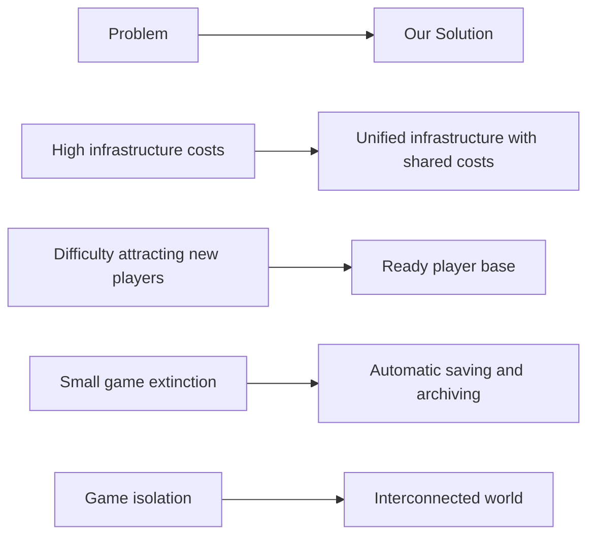
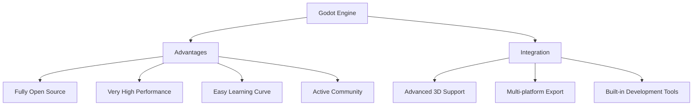
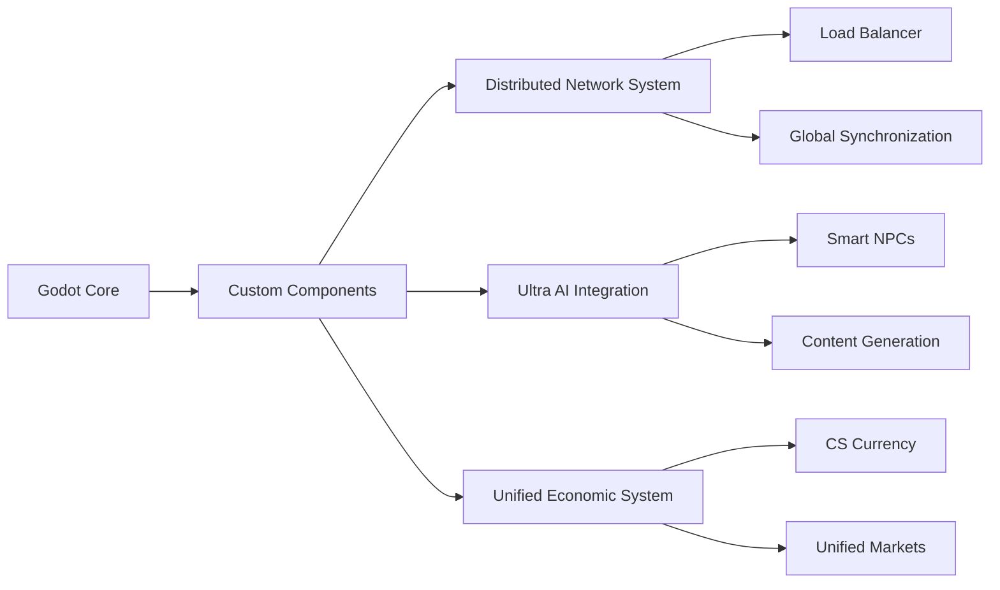
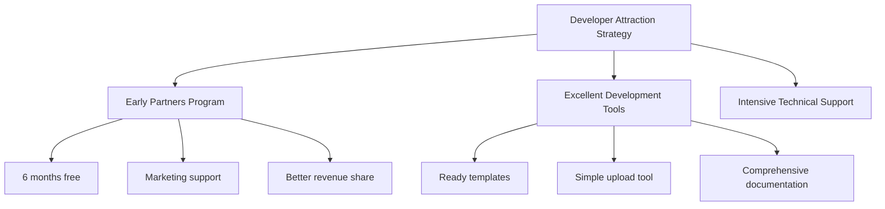
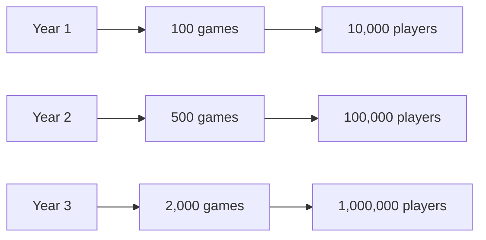
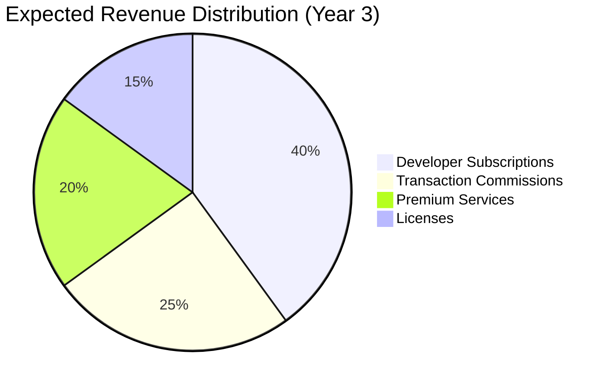

# 🎮 Technical Evaluation and Recommendations - MetaVerse Gaming Platform

## 💡 Innovation Assessment and Idea Strength

### Innovation Level: **Outstanding** ⭐⭐⭐⭐⭐

```mermaid
radar
    title Idea Strength Assessment in Terms of Innovation
    axis innovation ["Innovation"] 
    axis feasibility ["Feasibility"]
    axis market ["Market Size"]
    axis competition ["Competition"]
    
    curve ouridea ["Our Idea"] {9.5, 8, 9, 7.5}
    curve traditional ["Traditional Approach"] {3, 6, 8, 2}
    
    max 10
```

### Key Strengths:

#### 1. **Real Innovation in Business Model**
- ✅ **Transform from competition to collaboration model**: Instead of games competing, they become integrated
- ✅ **Economy of scale**: Resource pooling reduces costs for everyone
- ✅ **Strong network effect**: Each new game increases the platform's overall value

#### 2. **Solving Real Problems in Gaming Industry**


#### 3. **Perfect Timing with Market Trends**
- 📈 Metaverse market expected to reach **$800 billion** by 2028
- 📈 70% of game developers work in small and medium studios
- 📈 Strong trend toward Gaming as a Service

## 🛠️ Open Source Game Engine Recommendations

### Primary Recommended Engines:

#### 1. **Godot Engine** ⭐⭐⭐⭐⭐ (Optimal Choice)


**Godot Advantages for the Project:**
- **MIT License**: Completely free for commercial use and modification
- **Amazing Performance**: Modern engine written in C++ with Rust for critical components
- **Very Flexible**: Can modify the engine itself to suit our needs
- **Network Support**: Built-in with advanced networking system

#### 2. **Unreal Engine 5** (Using Royalty Model)
```javascript
// Pricing model
const unrealPricing = {
  license: "free-up-to-1-million",
  royalty: "5%-after-1-million",
  features: {
    graphics: "nanite-virtualized-geometry",
    lighting: "lumen-global-illumination",
    physics: "chaos-physics-system",
    ai: "behavior-trees-blackboards"
  }
};
```

#### 3. **Hybrid Option: Godot + Custom Components**


## 📊 Detailed Feasibility Study

### SWOT Analysis:

**Strengths:**
- 💪 Innovative business model not currently in the market
- 💪 Integration with existing ecosystem (Ultra AI, Gata-OS)
- 💪 Massive cost savings for developers
- 💪 Potential user base from day one

**Weaknesses:**
- ⚠️ High technical complexity initially
- ⚠️ Need massive developer adoption to succeed
- ⚠️ Strong infrastructure requirements

**Opportunities:**
- 🚀 Metaverse market growing at tremendous speed
- 🚀 Trend toward social and interconnected games
- 🚀 Opportunity to lead an entirely new market

**Threats:**
- ⚡ Competition from major companies like Meta, Microsoft
- ⚡ Technical challenges in achieving stability and performance
- ⚡ Change resistance from developers accustomed to traditional models

### Comparison with Existing Solutions:

| Criteria | Traditional Platform | Our Proposed Platform |
|----------|---------------------|----------------------|
| **Cost** | $10,000 - $100,000+ | $29 - $999/month |
| **Launch Time** | 6-24 months | Days or weeks |
| **Player Base** | Build from scratch | Access to existing community |
| **Sustainability** | Risk of extinction | Automatic saving and archiving |
| **Revenue** | 100% to developer | 70% to developer + additional revenue |

## 🌟 Critical Success Factors

### 1. **Early Developer Adoption**


### 2. **Exceptional Player Experience**
- Seamless world transitions without loading
- Progress saved across all games
- Unified social system
- Integrated economy

### 3. **Excellent Technical Performance**
- Response time under 50ms
- Support for thousands of concurrent players
- Dynamic world loading

## 💰 In-Depth Economic Feasibility Analysis

### Growth Projections:


### Multiple Revenue Sources:


## 🚀 Proposed Implementation Plan

### Phase 1: Prototype (6 months)
- **Engine**: Godot with basic modifications
- **Functions**: Two basic connected worlds
- **Goal**: Prove technology concept

### Phase 2: Basic Platform (12 months)
- **Expansion**: 10 connected worlds
- **Tools**: Developer SDK
- **Economy**: Unified currency system

### Phase 3: Maturity (18 months)
- **Scaling**: Support for thousands of worlds
- **AI**: Full integration with Ultra AI
- **Market**: Asset trading platform

## 📈 Key Performance Indicators (KPIs)

### For Phase 1 (6 months):
- ✅ 50 developers registered on platform
- ✅ 10 active games on platform
- ✅ 1,000 monthly active players
- ✅ 99.5% platform uptime

### For Phase 2 (12 months):
- ✅ 500 registered developers
- ✅ 100 active games
- ✅ 50,000 active players
- ✅ $50,000/month revenue

## 🔮 Future Vision and Development

### Long-term Development Trends:
1. **Virtual and Augmented Reality**: Full VR/AR device support
2. **Generative AI**: Automatically create complete worlds
3. **Blockchain**: True ownership of digital assets
4. **Education and Training**: Use platform for educational purposes

## Final Conclusion

**The idea is highly innovative and has the potential to transform the gaming industry** because of:

1. **Model Innovation**: From isolation to integration
2. **Perfect Timing**: With mature metaverse technologies
3. **Real Added Value**: For both developers and players
4. **Global Scalability**: Globally scalable business model

**Challenges are significant but solvable** with proper planning and excellent execution. Using open source engines like Godot reduces financial risks and provides high technical flexibility.

**Recommendation: Proceed with the project while focusing on building the developer community from day one.**

---

**✨ Evaluation by Ultra Cube Tech** - [www.ucubetech.com](https://www.ucubetech.com)